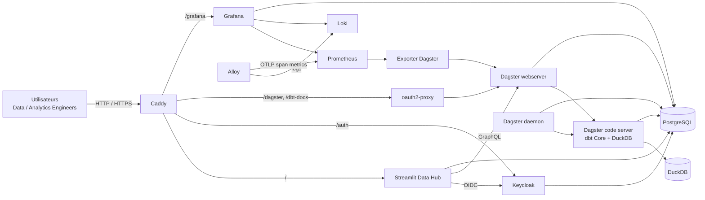

# Data Hub

**On-premise Data Orchestration, Transformation & Observability Platform** — 100 % Open Source, auto-hébergée sur une VM Linux SLES (VirtualBox) avec Docker Compose.

[](https://github.com/plyts/datahub/actions/workflows/ci.yml)

Plateforme interne permettant à une petite équipe Data de **créer, exécuter, planifier, superviser, documenter et maintenir** ses pipelines de données depuis une interface unique, sans multiplier les infrastructures à administrer.

| Couche | Technologie | Rôle dans le Data Hub |
|---|---|---|
| Interface | **Streamlit** | Data Hub : dashboard + 11 modules, RBAC, journal d'audit |
| Orchestration | **Dagster OSS** | Assets, jobs, schedules, sensors, retries, backfills, checks qualité |
| Transformation | **dbt Core** + dagster-dbt | Modèles SQL, tests, documentation, lineage |
| Analytique | **DuckDB** | Moteur analytique local (un fichier par environnement) |
| Métadonnées | **PostgreSQL 17** | Dagster, Keycloak, Grafana, base applicative du Data Hub |
| IAM / SSO | **Keycloak** | OIDC, rôles, groupes, sessions — SSO pour Data Hub, Dagster et Grafana |
| Point d'entrée | **Caddy** + **oauth2-proxy** | Reverse proxy unique (HTTP/HTTPS), protection OIDC de l'UI Dagster |
| Métriques | **Prometheus** | Métriques Dagster, VM, conteneurs, PostgreSQL, Keycloak… + alertes |
| Logs | **Grafana Loki** + **Alloy** | Logs de tous les conteneurs, OTLP |
| Traces | **OpenTelemetry** | Traces des appels de l'interface → métriques RED |
| Dashboards | **Grafana OSS** | 3 dashboards provisionnés (pipelines, infrastructure, logs & audit) |
| CI/CD | **GitHub Actions** / **Gitea + Woodpecker** | Tests, validation, déploiement, rollback |

## Architecture



Une seule VM, 17 conteneurs, un réseau Docker interne : **seul Caddy publie des ports**. Détails : [docs/architecture.md](docs/architecture.md).

## Démarrage rapide

Prérequis : Docker Engine + Docker Compose v2, 4–6 vCPU, 12–16 Go de RAM, 100–150 Go de disque. Sur SLES : `sudo ./scripts/bootstrap-sles.sh $USER` ([guide complet](docs/deployment-sles.md)).

```bash
git clone https://github.com/plyts/datahub && cd datahub
make secrets                      # .env avec des secrets aléatoires (jamais commité)
echo "127.0.0.1 datahub.local" | sudo tee -a /etc/hosts   # ou une entrée DNS vers la VM
make up ENV=dev                   # build + démarrage + attente des healthchecks
make seed-demo-users ENV=dev      # 4 comptes de démo (refusé en prod)
make smoke ENV=dev
```

| URL | Service | Accès |
|---|---|---|
| http://datahub.local/ | Data Hub (Streamlit) | Tous les rôles (pages filtrées par rôle) |
| http://datahub.local/dagster/ | UI native Dagster | ADMIN, DATA_ENGINEER |
| http://datahub.local/dbt-docs/ | Documentation dbt | ADMIN, DATA_ENGINEER |
| http://datahub.local/grafana/ | Grafana | Rôle Grafana dérivé du rôle Data Hub |
| http://datahub.local/auth/admin/ | Console Keycloak | Administrateur Keycloak (`.env`) |

Comptes de démo (mot de passe `DEMO_USERS_PASSWORD` du `.env`) : `alice.admin`, `eric.engineer`, `anna.analyst`, `victor.viewer`. Le premier administrateur réel est `DATAHUB_ADMIN_USERNAME` / `DATAHUB_ADMIN_PASSWORD`.

Premier chargement des données : dans **01 · Pipeline Management**, lancez `daily_partition_job`, ou un backfill des derniers jours dans **07 · Backfill & Recovery**.

## Les 11 modules

| # | Module | Ce qu'il fait |
|---|---|---|
| 01 | Pipeline Management | Liste et lancement des jobs, découverte des assets Dagster et modèles dbt, graphe de dépendances, historique, relance / arrêt, **pipelines créés sans code** (sélection d'assets + cron → job Dagster) |
| 02 | Scheduling Center | Schedules cron (start/stop), sensors événementiels, prochaines exécutions, couverture des partitions |
| 03 | Data Lineage Explorer | Lineage amont/aval, analyse d'impact (assets + exposures dbt), **lineage de colonnes** (sqlglot), historique des transformations |
| 04 | Data Catalog | Schémas, tables, colonnes (types, PII, tests), SQL source et compilé, aperçu des données (PII masquées selon le rôle), glossaire métier |
| 05 | Data Quality Center | Tests dbt et asset checks (NULL, unicité, intégrité référentielle, valeurs acceptées), fraîcheur, détection d'anomalies (z-score), historique |
| 06 | Logs & Error Management | Logs centralisés (Loki), logs de run, erreurs SQL/Python avec stack, classification automatique, incidents, notifications |
| 07 | Backfill & Recovery | Backfill de plages ou des partitions manquantes, relance depuis l'échec, annulation, traitements incrémentaux |
| 08 | Performance Monitoring | Durées p50/p90, ralentissements, comparaison de runs étape par étape, volumes, CPU / RAM / disque, conteneurs |
| 09 | Environment Management | DEV / STAGING / PROD, version Git, configuration, validations avant déploiement, CI/CD et rollback |
| 10 | Administration & Security | Santé des services, utilisateurs et rôles (Keycloak), connexions, politique des secrets, journal d'audit |
| 11 | Identity & Access Management | Profil, claims OIDC, matrice RBAC, groupes, sessions actives |

## Rôles

| Rôle | Droits |
|---|---|
| `ADMIN` | Administration complète |
| `DATA_ENGINEER` | Création, modification et exécution des pipelines |
| `ANALYST` | Consultation du catalogue, du lineage et de la qualité |
| `VIEWER` | Consultation des dashboards et des historiques |

Keycloak gère identités, rôles et groupes. Le Data Hub filtre ses pages et **revérifie chaque action sensible côté serveur** avant d'appeler Dagster ou Keycloak, puis l'inscrit au journal d'audit. L'UI native Dagster est protégée séparément par oauth2-proxy (ADMIN et DATA_ENGINEER uniquement). Voir [docs/security.md](docs/security.md).

## Tests et reproductibilité

| Suite | Commande | Contenu |
|---|---|---|
| Dagster + dbt | `make test-dagster` | 58 tests, dont de **vrais runs** du pipeline (ingestion → dbt → tests), l'idempotence, le backfill d'une plage en un run, les artefacts dbt docs, le sensor de fichiers et les **scénarios de panne** de la source simulée |
| Interface | `make test-ui` | 97 tests : RBAC, auth OIDC, clients, lineage de colonnes sur le vrai SQL compilé, **chaque page rendue pour chaque rôle**, audit des actions, traces OpenTelemetry |
| Configuration + déploiement | `make test-config` | 126 tests : Compose (ports, images épinglées, mémoire, variables, Docker Desktop, SELinux), Alertmanager, sauvegardes (restic, timer, métriques), OIDC interne, bootstrap SUSE (SLES 15/16, Leap 16), realm Keycloak ↔ RBAC, hygiène des secrets, routage Caddy, dashboards, **déployeur pull** (17 scénarios) |
| Alertes | `promtool test rules` | Tests unitaires des règles Prometheus (pipelines, infrastructure, sauvegardes) ; `amtool check-config` sur la configuration Alertmanager générée |
| Intégration | `make test-integration` | Dagster réel sur PostgreSQL : runs, ré-exécution, backfill, schedules/sensors, **pipeline créé depuis l'UI**, migrations et moindre privilège |
| E2E | `make test-e2e` | Stack complète via Caddy, **en HTTP et en HTTPS** (CA interne, mode production) : SSO Keycloak pour chaque rôle, RBAC de l'UI Dagster, pipeline exécuté à travers la plateforme, puis **sauvegarde → restauration → smoke tests** |

La CI GitHub Actions exécute tout cela à chaque push, y compris la **stack Docker Compose complète**, deux fois (HTTP et HTTPS) : build, healthchecks, SSO, RBAC, pipeline, cibles Prometheus, Alertmanager actif, logs Loki, dashboards Grafana, répétition de reprise après sinistre. Les dépendances Python sont verrouillées (`requirements.lock`), les images épinglées, et les dashboards générés depuis le code.

## Documentation

- [Architecture](docs/architecture.md) — composants, flux, choix techniques
- [Déploiement sur SLES / VirtualBox](docs/deployment-sles.md)
- [Exploitation](docs/operations.md) — environnements, déploiement, rollback, sauvegardes, supervision, alertes
- [Sécurité](docs/security.md) — SSO, RBAC, secrets, durcissement
- [Guide des modules](docs/modules.md) — usage du Data Hub et extension des pipelines
- [CI/CD](docs/cicd.md) — GitHub Actions, Gitea + Woodpecker

## Licence

[Apache 2.0](LICENSE). Les composants tiers conservent leurs licences respectives (voir [docs/architecture.md](docs/architecture.md#licences)) : à vérifier pour les versions retenues avant toute mise en production.
